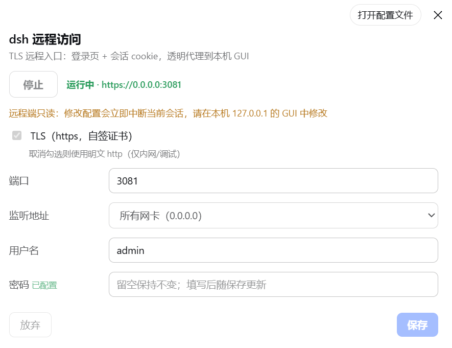

# dsh-remote-access（dsh 远程访问）

给 [DeepSeek Harness (dsh)](https://github.com/deepseek-ai/deepseek-harness) 的 web GUI 增加一个**自包含的 TLS 远程入口**：独立端口 + 自签证书 + 登录页 + 会话 cookie，之后透明代理到本机的 dsh web 服务器（默认 `127.0.0.1:3080`）。

> 把只在 `127.0.0.1` 上监听的 dsh GUI，安全地暴露给局域网 / frp 




## 功能

- **TLS edge**：独立端口（默认 `3081`）监听，自签证书（首次自动生成、自动续期）
- **登录门禁**：用户名 + 密码，登录后下发会话 cookie（`HttpOnly`/`SameSite=Lax`/`Secure`），按 IP 限速防爆破
- **透明代理**：HTTP 请求 + WebSocket 全部转发到回环 dsh，`Host`/`Origin` 改写为回环，dsh 的信任围栏照常把请求当作本地请求
- **设置面板**：GUI「设置 → 远程访问」一级菜单：「启动/停止」按钮（即时生效）+ 实时状态行 + TLS / 端口 / 监听地址 / 账号 / 密码（保存后热生效，改端口即时迁移，无需重启 dsh）
- **浏览器零改写**：GUI 原样加载；edge 仅在转发的 index.html 注入一行标记，让 dsh 客户端识别"本页 /api 由可信 edge 服务"


## 安装

> 前提：已有一个运行中的 dsh web 部署（本插件是它的 profile 插件）。

统一用 dsh 官方命令 **`dsh plugin`** 安装（Linux / macOS / Windows 通吃，无需手改任何 JSON——它自动完成 pnpm 安装，并自动把声明了 `dsh.bundle` 的依赖登记进 profile 的 bundles 层）。前提是机器上有 `dsh` CLI 和 `pnpm`。

### 方式一：从 GitHub 远程安装（推荐）

```bash
dsh plugin --profile web add github:zergtant/dsh-remote-access
```

### 方式二：本地目录安装

```bash
cd /path/to/dsh-remote-access
dsh plugin --profile web add .
```

### 方式三：npm 安装

暂不支持
### 升级 / 卸载

```bash
dsh plugin --profile web update dsh-remote-access   # 升级（git 源重新拉取）
dsh plugin --profile web remove dsh-remote-access   # 卸载（bundles 登记自动移除）
```

> 安装完都必须**重启 dsh** 生效。插件默认 `enabled: false`，不会自动监听任何端口，需在 GUI 里显式开启。

## 使用

1. 重启 dsh 后，打开 GUI：**设置 → 远程访问**
2. 设置**密码**（必填，公网暴露时的唯一口令）、用户名（默认 `admin`）
3. 点页面顶部的**「启动」**按钮（即时生效，不用点保存）→ 立即在 `0.0.0.0:3081` 监听，按钮旁显示"运行中 · https://…"
4. 访问：
   - 本机：`https://127.0.0.1:3081`
   - 局域网：`https://<主机IP>:3081`
   - 公网：把 frp 隧道指向 `127.0.0.1:3081`
5. 浏览器首次访问会提示**自签证书不受信任**——点"高级 → 继续访问"即可（或用 `curl -k` 验证）。
   如果不想看这个提示，可以取消 **TLS** 复选框改用明文 http（但dsh有个小bug，所以这个方式是为cf反代使用）

### 配置项（设置卡片）

| 字段 | 默认 | 说明 |
|---|---|---|
| 启动/停止 | — | 页面顶部操作区：点「启动」立即拉起、点「停止」立即停止（均无需保存）；按钮旁实时显示 `运行中 · https://host:port` / `未启用` |
| TLS（https） | 开 | 自签 https；**关闭 = 明文 http**（内网/调试用，省掉浏览器证书告警），保存后生效 |
| 端口 | `3081` | 1–65535，保存后即时迁移监听 |
| 监听地址 | `0.0.0.0` | `0.0.0.0`（对外）/ `127.0.0.1`（仅本机，例如只给 frp 用） |
| 用户名 | `admin` | 登录用户名 |
| 密码 | — | 存 dsh 凭据库（`~/.dsh/.credentials.yaml`，0600），设置里留空=保持不变 |

**启动/停止永远用**已保存的配置**；TLS/端口/监听地址/用户名/密码改完都处于"未保存草稿"状态，点「保存」才应用——运行中保存 = 立即热迁移，停止中保存 = 下次启动生效。有未保存更改时页面显示琥珀色横幅提示，避免误以为服务已按新配置运行。

## 安全模型

- **主服务零暴露**：dsh 主 web 服务器仍只绑 `127.0.0.1`；对外只有本插件的 `3081`。
- **唯一门禁 = 登录口令**：edge 之后的 /api（含特权设置面）都由登录 cookie 保护。公网暴露时**务必使用强密码**。
- **证书**：自签（`localhost`/`127.0.0.1` SAN，10 年有效期，<30 天自动续期）。浏览器会告警；如需消除告警，可把 frp 终结 TLS 或用可信域名证书替换 `~/.dsh/dsh-remote-access/*.pem`。
- **http 模式（TLS 关闭）**：登录口令与会话 cookie **明文过网**，仅可用于受信任的内网或调试；公网暴露请保持 TLS 开启。

> 公网部署建议：配合 frp 的 `tls_enable`、SSH 跳板、或在更外层（frp/nginx/Caddy）再套一层可信证书与 IP 白名单。本插件只负责"TLS + 登录"，不替代网络层防护。

## 开发

```bash
# 改浏览器端后重新打包
npm install            # 装 esbuild（devDependency）
npm run build:client   # src/client.tsx → lib/client.js
# 宿主端是纯 JS，改完直接同步
npm run build:host     # src/index.js → lib/index.js
# 或一次全构建
npm run build
```

`lib/` 已随仓库提交（可直接安装）；`src/` 是源。

## 卸载

```bash
dsh plugin --profile web remove dsh-remote-access   # 移除依赖 + bundles 登记，并 pnpm install
```

然后重启 dsh；可选删除残留：`~/.dsh/dsh-remote-access/`（自签证书）与凭据库里的 `DSH_REMOTE_ACCESS_PASSWORD`（`~/.dsh/.credentials.yaml`）。

## 已知限制

- 自签证书会触发浏览器告警（见上"安全模型"）。
- 会话为内存态，dsh 重启后需重新登录。
- 单进程单 edge：一个 dsh 实例对应一个 3081；多实例需改端口。
- **设置面依赖 dsh 构建**：GUI 里的「远程访问」设置页需要 dsh 源码包含 settings-origin 标记支持。在**干净的上游 dsh 全新安装**上，edge 的代理 / 登录 / TLS 全部正常，但 GUI 内改设置可能不落盘（客户端按不可信来源降级）；命令行 / 配置文件方式改 `~/.dsh/settings.yaml` 的 `remote-access` 段不受影响。

## License

[MIT](./LICENSE)
